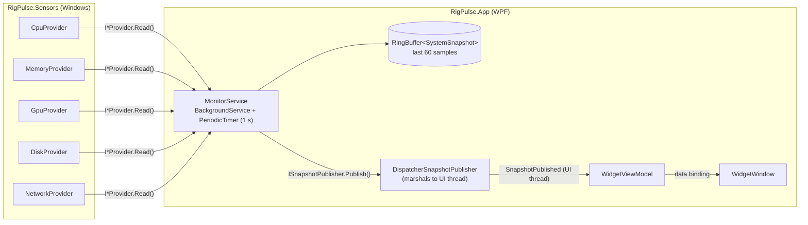

# RigPulse

A lightweight, always-on-top floating widget that shows live CPU, RAM, GPU, disk and network stats on Windows.


<!-- TODO: record a short demo GIF and save it as docs/demo.gif -->

[](../../actions/workflows/build.yml)

## Features

### Phase 1: live stats widget ✅

- **CPU** total load (`Processor Information\% Processor Utility`, the same counter Task Manager uses)
- **RAM** used / total / % (`GlobalMemoryStatusEx`)
- **GPU** 3D-engine load, computed the way Task Manager does (sum of `GPU Engine` 3D instances, busiest adapter)
- **Disk** read and write throughput (`PhysicalDisk(_Total)`)
- **Network** upload and download throughput (physical adapters only, see [Notes](#notes))
- Borderless, semi-transparent, rounded widget that you can drag from anywhere
- Remembers its position between runs and pulls itself back on screen if your monitors change
- Right-click menu: *Always on top* toggle and *Exit*
- No admin rights needed; a missing counter shows `–` instead of crashing
- Light on resources: about 0.3% CPU at steady state on a 12-thread machine

### Roadmap

| Phase | Scope |
|-------|-------|
| 2 | Hardware temperatures, clocks and fan speeds via [LibreHardwareMonitorLib](https://github.com/LibreHardwareMonitor/LibreHardwareMonitor) |
| 3 | History graphs (the 60-sample history buffer is already wired up) |
| 4 | Top processes by CPU/RAM, with kill |
| 5 | Tray icon, settings window, themes, start with Windows |
| 6 | Threshold alerts and long-term history stored in SQLite |

## Tech stack

- **.NET 10** and **C# 14**
- **WPF** for the UI
- **CommunityToolkit.Mvvm** for MVVM (source-generated observable properties and commands)
- **Microsoft.Extensions.Hosting** for dependency injection, configuration, logging and the background service
- **xUnit v3** and **Shouldly** for tests, run on Microsoft.Testing.Platform
- Central Package Management, nullable reference types, warnings treated as errors, `latest-recommended` analyzers
- GitHub Actions CI on `windows-latest`

## Architecture



| Project | Purpose |
|---------|---------|
| `RigPulse.Core` | Platform-neutral models (`SystemSnapshot`, `CpuStats`...), provider abstractions, `RingBuffer<T>` and `ByteFormatter`. No Windows dependencies. |
| `RigPulse.Sensors` | Windows implementations of the providers (performance counters plus `LibraryImport` P/Invoke). Exposes only `AddRigPulseSensors()`. |
| `RigPulse.App` | WPF app and composition root: Generic Host, the monitoring loop, view models, the window and persisted settings. |
| `RigPulse.Core.Tests` | Unit tests for Core. |

**Threading.** `MonitorService` polls on a thread-pool thread. Each snapshot goes into the ring buffer and is handed to `ISnapshotPublisher`. The WPF publisher never blocks the poller. It queues at most one delivery on the Dispatcher, and if the UI falls behind, only the newest snapshot is delivered. The UI thread never polls.

**Resilience.** Providers never throw. If a counter is missing, the provider logs one warning, returns `null` (shown as `–`) and retries every 30 s. `MonitorService` also wraps each provider call, so one faulty provider can't stop the loop.

## Build and run

Requirements: Windows 10/11 and the [.NET 10 SDK](https://dotnet.microsoft.com/download/dotnet/10.0).

```powershell
git clone <repo-url> RigPulse
cd RigPulse
dotnet build
dotnet test
dotnet run --project src/RigPulse.App
```

Settings are stored in `%AppData%\RigPulse\settings.json` (position, opacity, always-on-top). Polling options live in `src/RigPulse.App/appsettings.json`:

```json
"Monitor": { "PollInterval": "00:00:01", "HistoryCapacity": 60 }
```

Logs are written to the debugger output window (Visual Studio *Output* pane, or [DebugView](https://learn.microsoft.com/sysinternals/downloads/debugview)).

## Notes

- **First reading.** On a cold start, Windows can take several seconds to load performance-counter metadata. The widget shows `–` until the first sample arrives. This happens on a background thread and doesn't block the UI.
- **Network.** RigPulse counts only physical adapters (`GetIfTable2` with the hardware-interface flag set and the filter-interface flag clear). The managed `NetworkInterface` API also lists every NDIS filter layer (WFP, QoS, VPN filters) as a separate "Up" interface with the same counters, so summing those multiplies the real traffic. VPN and virtual-switch traffic is still counted, on the physical adapter it actually leaves through.
- **GPU.** On machines with more than one GPU (e.g. integrated plus discrete), RigPulse shows the busiest adapter rather than adding them together. GPUs without WDDM 2.0+ counters show `–`.
