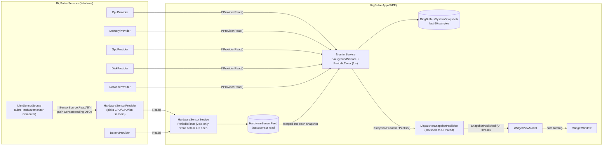

# RigPulse

A lightweight, always-on-top floating widget that shows live CPU, RAM, GPU, disk and network stats on Windows, plus temperatures, clocks, fans and battery on demand.


<!-- TODO: record a short demo GIF and save it as docs/demo.gif -->

[](../../actions/workflows/build.yml)

## Features

### Phase 1: live stats widget ✅

- **CPU** total load (`Processor Information\% Processor Utility`, the same counter Task Manager uses)
- **RAM** used / total / % (`GlobalMemoryStatusEx`)
- **GPU** 3D-engine load, computed the way Task Manager does (sum of `GPU Engine` 3D instances, busiest adapter)
- **Disk** read and write throughput (`PhysicalDisk(_Total)`)
- **Network** upload and download throughput (physical adapters only, see [Notes](#notes))
- Borderless, semi-transparent, rounded widget that you can drag from anywhere
- Remembers its position between runs and pulls itself back on screen if your monitors change
- Right-click menu: *Always on top* toggle and *Exit*
- No admin rights needed; a missing counter shows `–` instead of crashing
- Light on resources: about 0.3% CPU at steady state on a 12-thread machine

### Phase 2: hardware sensors ✅

Click the small chevron at the bottom of the widget (or right-click → *Show details*) to open a details section. The widget remembers whether it is open.

- **CPU** package temperature, plus average and maximum core clock
- **GPU** core temperature, core clock, and VRAM used / total (e.g. `3.1 / 8.0 GB`)
- **Fans**: RPM for every fan that is spinning. Fans reading 0 or nothing are hidden.
- **Battery** (laptops only): charge, charging / discharging, and estimated time left. Hidden on desktops.
- Temperatures turn amber from 70 °C and red above 85 °C (`TemperatureLevels` in Core)
- Read with [LibreHardwareMonitorLib](https://github.com/LibreHardwareMonitor/LibreHardwareMonitor) 0.9.6 (battery uses `GetSystemPowerStatus`)
- Works without admin. Sensors that need admin show `–` with a hint, and right-click → *Restart as administrator* relaunches elevated. See [Admin rights and drivers](#admin-rights-and-drivers).
- Sensors are read only while the details are open, so the collapsed widget costs the same as before.

### Roadmap

| Phase | Scope |
|-------|-------|
| 3 | History graphs (the 60-sample history buffer is already wired up) |
| 4 | Top processes by CPU/RAM, with kill |
| 5 | Tray icon, settings window, themes, start with Windows |
| 6 | Threshold alerts and long-term history stored in SQLite |

## Tech stack

- **.NET 10** and **C# 14**
- **WPF** for the UI
- **CommunityToolkit.Mvvm** for MVVM (source-generated observable properties and commands)
- **Microsoft.Extensions.Hosting** for dependency injection, configuration, logging and the background service
- **xUnit v3** and **Shouldly** for tests, run on Microsoft.Testing.Platform
- Central Package Management, nullable reference types, warnings treated as errors, `latest-recommended` analyzers
- GitHub Actions CI on `windows-latest`

## Architecture



| Project | Purpose |
|---------|---------|
| `RigPulse.Core` | Platform-neutral models (`SystemSnapshot`, `CpuStats`, `SensorReading`...), provider abstractions (including `ISensorSource`), the sensor-selection logic (`HardwareSensorSelector`), `RingBuffer<T>` and the formatters. No Windows dependencies and no LibreHardwareMonitor types. |
| `RigPulse.Sensors` | Windows implementations of the providers (performance counters, `LibraryImport` P/Invoke, and `LhmSensorSource`, the only class that touches LibreHardwareMonitorLib). Exposes only `AddRigPulseSensors()`. |
| `RigPulse.App` | WPF app and composition root: Generic Host, the two monitoring loops, admin relaunch, view models, the window and persisted settings. |
| `RigPulse.Core.Tests` | Unit tests for Core, including the CPU/GPU/fan sensor selection against fake sensor data. |
| `RigPulse.Sensors.Tests` | Unit tests for the battery-status mapping and GPU selection across reads. |

**Threading.** `MonitorService` polls on a thread-pool thread. Each snapshot goes into the ring buffer and is handed to `ISnapshotPublisher`. The WPF publisher never blocks the poller. It queues at most one delivery on the Dispatcher, and if the UI falls behind, only the newest snapshot is delivered. The UI thread never polls.

**Hardware sensors.** `Computer.Update()` is expensive. On the development laptop (i7-9850H + Quadro T2000), one read of CPU, GPU and mainboard takes about 100 ms of wall time but about 30 ms of CPU. Most of the wait is NVIDIA driver calls, and the first `Open()` can take several seconds on a cold start. So `HardwareSensorService` reads sensors on its own loop every `SensorPollInterval` (default 2 s), and only while the details section is open. `MonitorService` keeps its 1 s cadence and copies the latest sensor read into each snapshot. The library's `Computer` is a singleton that is opened lazily on the sensor thread, refreshed with an `IVisitor`, and closed when the host is disposed.

**Resilience.** Providers never throw. If a counter is missing, the provider logs one warning, returns `null` (shown as `–`) and retries every 30 s. `MonitorService` also wraps each provider call, so one faulty provider can't stop the loop.

## Build and run

Requirements: Windows 10/11 and the [.NET 10 SDK](https://dotnet.microsoft.com/download/dotnet/10.0).

```powershell
git clone <repo-url> RigPulse
cd RigPulse
dotnet build
dotnet test
dotnet run --project src/RigPulse.App
```

Settings are stored in `%AppData%\RigPulse\settings.json` (position, opacity, always-on-top, details open). Polling options live in `src/RigPulse.App/appsettings.json`:

```json
"Monitor": { "PollInterval": "00:00:01", "SensorPollInterval": "00:00:02", "HistoryCapacity": 60 }
```

Logs are written to the debugger output window (Visual Studio *Output* pane, or [DebugView](https://learn.microsoft.com/sysinternals/downloads/debugview)).

## Admin rights and drivers

RigPulse runs as a normal user (`asInvoker` manifest) and never asks for admin on its own.

| Sensor | No admin | Admin, no PawnIO | Admin + PawnIO |
|--------|:--------:|:----------------:|:--------------:|
| CPU, RAM, GPU %, disk, network (Phase 1) | ✅ | ✅ | ✅ |
| GPU temperature, clock, VRAM (NVIDIA, AMD) | ✅ | ✅ | ✅ |
| Battery | ✅ | ✅ | ✅ |
| CPU temperature and clocks | – | – | ✅ |
| Mainboard fans (Super I/O) | – | – | ✅ |

- **Not elevated:** admin-only sensors show `–`, and the details show *Run as admin for temps*. Right-click → *Restart as administrator* starts an elevated copy (UAC prompt) and closes this one. If you decline the prompt, nothing changes.
- **Elevated without PawnIO:** the hint changes to *Install PawnIO for CPU temps*.

**The driver.** Reading CPU temperatures and clocks means reading model-specific registers, which needs a kernel driver. LibreHardwareMonitor used to bundle **WinRing0**, which Microsoft Defender now flags as a vulnerable driver. Since **0.9.5**, LibreHardwareMonitorLib uses **[PawnIO](https://pawnio.eu)** instead. PawnIO is a separately installed, signed driver that runs only small, verified modules (the library embeds the ones it needs), and Defender doesn't flag it.

RigPulse **doesn't ship or install any driver**. If you want CPU temperatures, install PawnIO yourself from [pawnio.eu](https://pawnio.eu) or its [GitHub releases](https://github.com/namazso/PawnIO.Setup/releases), then run RigPulse as administrator. Without it, everything else still works. RigPulse detects PawnIO through its uninstall registry key.

## Notes

- **First reading.** On a cold start, Windows can take several seconds to load performance-counter metadata. The widget shows `–` until the first sample arrives. This happens on a background thread and doesn't block the UI.
- **Network.** RigPulse counts only physical adapters (`GetIfTable2` with the hardware-interface flag set and the filter-interface flag clear). The managed `NetworkInterface` API also lists every NDIS filter layer (WFP, QoS, VPN filters) as a separate "Up" interface with the same counters, so summing those multiplies the real traffic. VPN and virtual-switch traffic is still counted, on the physical adapter it actually leaves through.
- **GPU.** On machines with more than one GPU (e.g. integrated plus discrete), RigPulse shows the busiest adapter rather than adding them together. GPUs without WDDM 2.0+ counters show `–`.
- **Which GPU the details show.** The details follow the same rule: the busiest adapter by 3D load. It must lead by at least 10 points, otherwise the choice counts as ambiguous (typically everything is idle) and the discrete GPU is shown. Only adapters that report a temperature, clock or VRAM are considered, so an Optimus laptop shows the dedicated GPU rather than an Intel iGPU with nothing to report. The choice only switches when another GPU is clearly busier, so it doesn't flicker. Hover the GPU row to see which adapter it is.
- **Sensors depend on your hardware.** RigPulse shows what LibreHardwareMonitor can read on your machine, so some values may be `–`:
  - CPU temperature uses the first available of `CPU Package` (Intel), `Core (Tctl/Tdie)`, `Tctl/Tdie`, `Core (Tdie)`, `Tdie`, `Core (Tctl)`, `Tctl` (AMD), `CPU Cores` (older AMD), `Core Max`, `Core Average`.
  - VRAM comes from the vendor API (`GPU Memory Used/Total`) or Windows' D3D statistics (`D3D Dedicated Memory`). Integrated GPUs have no dedicated VRAM and show `–`.
  - **Fans** come from the mainboard's Super I/O chip (desktops, needs admin + PawnIO) and from the graphics card. Most **laptops don't expose fan speeds** through a supported chip, so they show no fan rows. USB fan controllers (Corsair, NZXT...) aren't read, because probing them means writing to serial ports.
  - **Battery** needs no special access. Windows estimates time left only while discharging, and only after a few seconds on battery.
